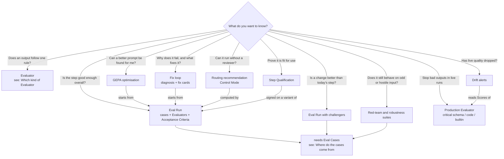
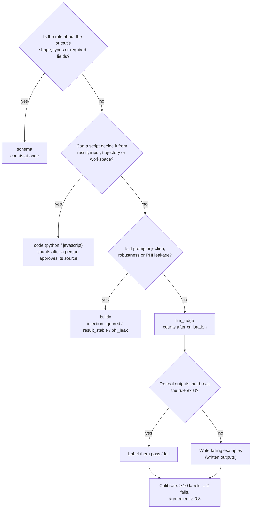

# Choosing an evaluation

Which part of Step Evaluation to use, given **what you want to know** and
**what data you have**. Each answer names the feature and where to find it; the
full behaviour of each is in
[`../reference/step-evaluation.md`](../reference/step-evaluation.md), and a
hands-on walk through the tab is in
[`step-evaluation-manual-test.md`](step-evaluation-manual-test.md).

Everything here belongs to **one agent step**: open the workflow's
**Evaluation** tab and pick the step. Nothing you add there creates a new
workflow version.

## Before you start

- The step is an **agent** step, and its MCP servers are bound to its agent,
  not declared inline on `agent.mcpServers` — a step with inline servers cannot
  be evaluated.
- The workspace has an `OPENROUTER_API_KEY` secret. The Evaluation Assistant,
  LLM judges, previews and GEPA spend it.
- You have the workflow's `edit` verb to change checks and cases, and `run` to
  preview checks and run Eval Runs.
- Write the step's **Evaluation Brief** first: what the step is for, who relies
  on its output, which failures matter most. The assistant reads it on every
  turn, and a step cannot be qualified without one.

Not sure where to begin? Ask the Evaluation Assistant for an **evaluation
plan**. It reads the step, some of its runs and the Brief, and returns the risks
ranked by severity, the cheapest check for each, and suggested Acceptance
Criteria. It creates nothing until you accept a card.

## Decision chart: what do you want to know?

## Goal → data → feature

| You want to check… | You have… | Use | Where |
|---|---|---|---|
| The output has the right shape and fields | the step's `outputSchema` | `schema` Evaluator | **Evaluators → Add**, or ask the assistant for a rule |
| A rule a script can decide (value ranges, cross-field logic, file exists in the workspace) | a rule in plain language | `code` Evaluator — counts once a person approves its source | **Evaluators → Add**; `mediforce eval evaluator-preview` first |
| A rule that needs judgment (rationale supports the grade, tone, completeness) | a rule plus outputs a person can label | `llm_judge` Evaluator, calibrated | **Evaluators → Add**, then **Label outputs** → **Calibrate** |
| A judge, but production never produced a failing output | real runs whose output you can edit | **Written outputs** to label | **Write an example**, or the assistant's drafts |
| The step ignores instructions injected into its data | one production run with a text field it reads | `prompt_injection` suite + `injection_ignored` | **Eval Cases → Built-in case suites** |
| The answer doesn't change when the input is reformatted | one production run | `robustness` suite + `result_stable` | **Eval Cases → Built-in case suites** |
| No patient identifiers leak into the output | outputs to check | `phi_leak` built-in — also usable live | **Evaluators → Add → Built-in** |
| The step behaves on inputs production never sent (missing file, edge values, renamed columns) | a production run to start from | synthesized case | assistant's case synthesis, or `mediforce eval case-perturb` |
| How often the step passes, with a confidence interval | Evaluators and a frozen Dataset | Eval Run + report | **Eval Runs**, `mediforce eval run-prepare` |
| Whether the step is good enough to ship | the above plus floors per severity | **Acceptance Criteria** judged in the Eval Run report | assistant proposes them; `mediforce eval criteria-set` |
| Whether another model, prompt, tool set or few-shot examples do better | an idea for the change | challenger in an Eval Run (up to 3) | assistant prepares it; `run-prepare --challengers` |
| Why trials failed and how to fix them | a finished Eval Run with failures | **diagnosis** and **fix** cards → **Try it** → **Apply to step** | ask the assistant; `mediforce eval failures` |
| A better prompt without writing one | a finished Eval Run with failing **dev** trials, and holdout cases | GEPA optimisation | **Optimisations**, `mediforce eval optimise` |
| Whether the step can skip human review | an Eval Run whose agent reports confidence, with criteria set | routing recommendation in the report | apply it in the workflow editor |
| That the step keeps passing in production | an Evaluator that counts | **Also run in production** | toggle on the Evaluator |
| That live quality hasn't dropped | production Scores from those Evaluators | drift alerts | banner in the tab; `mediforce eval drift` |
| Signed evidence the step is fit for its context of use | a finished Eval Run with a Brief and criteria frozen in it | Step Qualification | **Approve step configuration** in the report (web only) |

## Which kind of Evaluator

Pick the cheapest kind that can decide the rule. The assistant follows the same
order when you describe a rule in plain language.

- Preview any check on real outputs before saving it (`evaluator-preview`, or
  let the assistant do it — it previews every card it proposes). A `code`
  preview starts a sandbox per output and a judge preview pays per output.
- `injection_ignored` and `result_stable` grade an output against the case it
  ran on, so they only grade in an Eval Run over their own suite's cases.
- Only an Evaluator that **counts** feeds Acceptance Criteria, routing and
  qualification. An unapproved `code` check or an uncalibrated judge shows
  Scores but is marked as not counting.

## Where do the cases come from

An Eval Case is an **input** the step is re-run on, with whether its output
should be accepted (positive) or not (negative). A label is a pass/fail on an
**output** that already exists, and only calibrates a judge — do not mix them
up.

| Data you have | How to get cases |
|---|---|
| Production runs a reviewer approved or rejected | **Production runs to add as Eval Cases** → Positive / Negative, or `case-from-run` — the review decides the expectation |
| Production runs nobody reviewed | the same, choosing the expectation yourself (`case-from-run --expectation`) |
| Outputs you labelled for a judge | `cases-from-labels` turns labelled production outputs into cases (written outputs are skipped) |
| A real run you want to push to its edges | synthesized case: missing or extra file, edge values, renamed columns, injected instruction (`case-perturb`, or the assistant) |
| A real run you want to attack | built-in case suite: `prompt_injection` or `robustness` on one field (`case-red-team`) |
| No production run at all, or an input production never sent | **Write a case** from an existing case's input or a `.json` file (`case-add --file`) |

Then:

1. Mark some cases **holdout**. GEPA never sees them, and they are what tells a
   real improvement from one fitted to the dev cases.
2. **Freeze dataset.** An Eval Run runs a frozen version, never the live list,
   so a case you add or edit reaches the next run only after a freeze.
3. If the step uses MCP servers, set the **MCP eval policy**: `live` for
   read-only servers, `replay` for side-effecting ones once a live trial has
   recorded them, `deny` for anything the trial must not touch. Unnamed servers
   are denied.

## Roadmap: from nothing to a qualified step

The usual order. Skip what your goal does not need — a step you only want
guarded in production needs steps 1–3 and 9, not a qualification.

1. **Brief.** Write the Evaluation Brief.
2. **Plan.** Ask the assistant for an evaluation plan; accept its suggested
   Acceptance Criteria, or set your own floors per severity.
3. **Evaluators.** Draft a check for each risk, cheapest kind first. Approve
   `code` sources; label and calibrate judges.
4. **Cases.** Harvest from production, add negatives, synthesized and red-team
   cases; split dev / holdout; freeze.
5. **Eval Run.** Check the cost estimate, start, confirm the budget. Read the
   report: pass rate with Wilson interval, pass@k, pass^k, flakiness, criteria
   met / missed / not judged.
6. **Fix loop.** On failures, ask the assistant to diagnose. Try a fix as a
   challenger; compare it with the champion (`better` / `worse` only when the
   intervals do not overlap); **Apply to step** once it wins.
7. **Optimise** (optional). Run GEPA from the Eval Run with a budget; pick the
   candidate with the best holdout pass rate and apply it.
8. **Routing.** Apply the recommended Control Mode in the workflow editor. It does not change the Step Fingerprint, so it keeps a
   qualification.
9. **Production guardrails.** Turn on **Also run in production** for the
   checks that should score live runs. A failing **critical** `schema`, `code`
   or `builtin` check fails the run; judges only write Scores.
10. **Qualify.** Sign a Step Qualification on the variant that meets the
    criteria, justifying any criterion it missed.
11. **Watch.** Drift alerts tell you when a production Evaluator's recent mean
    drops. The qualification badge turns **Stale** when the step changes;
    re-run and re-sign.

## What it costs

- Previews, judges, the assistant and GEPA spend the workspace's OpenRouter key.
- An Eval Run never starts without a person confirming its budget (or an
  unattended budget granted to the assistant for one request). It stops at the
  budget and ends `budget_exceeded`.
- Cost scales with cases × `trialsPerCase` × variants, plus one judge call per
  judge per trial. Start with a small dataset and one trial per case; raise
  `trialsPerCase` when you need pass^k or a tighter interval — 30 passes out of
  30 gives a lower bound of 0.89.
