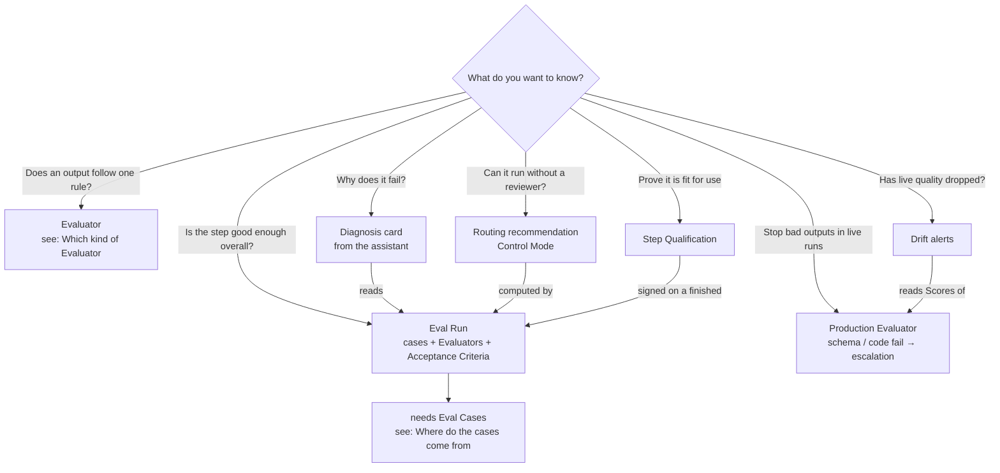
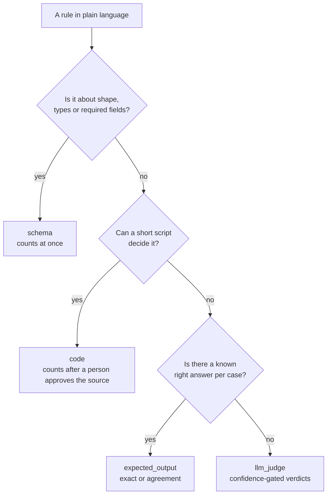

# Choosing an evaluation

Which part of Step Evaluation to use, given **what you want to know** and
**what data you have**. Each answer names the feature and where to find it; the
full behaviour of each is in
[`../reference/step-evaluation.md`](../reference/step-evaluation.md), and a
hands-on walk through the tab is in
[`step-evaluation-manual-test.md`](step-evaluation-manual-test.md). The
in-app walkthrough is the **Guide** button on the Evaluation tab; its chapter
is `workflow-evaluation` in `packages/platform-ui/src/lib/tour-content.ts` —
update it when the tab's wording changes.

Everything here belongs to **one agent step**: open the workflow's
**Evaluation** tab and pick the step. Nothing you add there creates a new
workflow version.

## Before you start

- The step is an **agent** step, and its MCP servers are bound to its agent,
  not declared inline on `agent.mcpServers` — a step with inline servers cannot
  be evaluated.
- The workspace has an `OPENROUTER_API_KEY` secret. The Evaluation Assistant,
  LLM judges and previews spend it.
- You have the workflow's `edit` verb to change checks and cases, and `run`
  to preview checks and run Eval Runs.
- Optionally write the step's **Evaluation Brief**: what the step is for, who
  relies on its output, which failures matter most. The assistant reads it on
  every turn. Nothing requires it — an Eval Run and a Step Qualification work
  without one.

Not sure where to begin? Ask the Evaluation Assistant for an **evaluation
plan**. It reads the step, some of its runs and the Brief, and returns the risks
ranked, the cheapest check for each, and a suggested minimum pass rate. It
creates nothing until you accept a card.

## Decision chart: what do you want to know?

## Goal → data → feature

| You want to check… | You have… | Use | Where |
|---|---|---|---|
| The output has the right shape and fields | the step's `outputSchema` | `schema` Evaluator | **Evaluators → Add**, or ask the assistant for a rule |
| A rule a script can decide (value ranges, cross-field logic, file exists in the workspace) | a rule in plain language | `code` Evaluator — counts once a person approves its source | **Evaluators → Add**; `mediforce eval evaluator-preview` first |
| A rule that needs judgment (rationale supports the grade, tone, completeness) | a rule in plain language | `llm_judge` Evaluator — counts at once; verdicts below its minimum confidence are left out until a person accepts them | **Evaluators → Add**; review verdicts in the Eval Run report |
| The output matches a known answer | a case with an expected output | `expected_output` Evaluator — exact match, or an agreement score | **Evaluators → Add**; set the expected output on the case |
| The step behaves on inputs production never sent (missing file, edge values, renamed columns, an injected instruction) | a production run to start from | synthesized case | the assistant's case synthesis, or `mediforce eval case-perturb` |
| How often the step passes, with a confidence interval | Evaluators and a saved Dataset | Eval Run + report | **Eval Runs**, `mediforce eval run-prepare` |
| Whether the step is good enough to ship | the above plus a floor | **Acceptance Criteria** judged in the Eval Run report | **Edit** beside Acceptance Criteria in the status strip; the assistant proposes a floor; `mediforce eval criteria-set` |
| Why a run failed | a finished Eval Run with failures | **diagnosis** card | ask the assistant; `mediforce eval failures <evalRunId>` |
| Whether the step can drop its reviewer | a finished Eval Run | routing recommendation (Control Mode 4 when the criteria were met) | the report; apply it in the workflow editor |
| Bad outputs stopped in live runs | a `schema` or `code` Evaluator | **Also run in production**; **Escalate** so an outage of the check stops the run too | Evaluator toggle, `mediforce eval evaluator-production` (`--on-error`) |
| Live quality has dropped | production Evaluators | drift alerts | banner on the tab, `mediforce eval drift` |
| Someone signed that this configuration is fit for use | a finished Eval Run | Step Qualification | **Confirm** or **Overwrite** the run's verdict in the report (web only) |

## Which kind of Evaluator

Pick the cheapest kind that can decide the rule.

- Preview any check on real outputs before saving it (`evaluator-preview`, or
  let the assistant do it — it previews every card it proposes). A `code`
  preview starts a sandbox per output and a judge preview pays per output.
  `expected_output` cannot be previewed: a production output has no expected
  output.
- An `llm_judge` verdict below its `minConfidence` is shown in the report but
  left out of the pass rate until a person **accepts** it; a person can
  **deny** any verdict. Read the rationale before you do either.
- Only an Evaluator that **counts** feeds Acceptance Criteria, routing and
  validation. An unapproved `code` check shows Scores but is marked as not
  counting.

## Where do the cases come from

An Eval Case is an **input** the step is re-run on, optionally with the output
expected of it (positive: it must match; negative: it must not).

| Data you have | How to get cases |
|---|---|
| Production runs a reviewer approved or rejected | **Eval Cases → Add case** from the run, or `case-from-run` — approval makes a positive case, rejection a negative one |
| Production runs nobody reviewed | the same, choosing the expectation yourself (`case-from-run --expectation`) |
| A real run you want to push to its edges | synthesized case: missing or extra file, edge values, renamed columns, injected instruction (`case-perturb`, or the assistant) |
| No production run at all, or an input production never sent | **Add case** from an existing case's input, a `.json` file or an empty input (`case-add --file`) |

Then:

1. Mark cases **dev** or **holdout** as you add them.
2. **Save** (`dataset-save`). An Eval Run runs a saved Dataset version,
   never the live list, so a case you add or edit reaches the next run only
   after a save.
3. If the step uses MCP servers, set the **MCP eval policy** with
   `mediforce eval mcp-policy-set`: `live` for read-only servers, `replay` for
   side-effecting ones once a trial has recorded them, `deny` for anything the
   trial must not touch. A server the policy does not name runs live.

## Roadmap: from nothing to a qualified step

The usual order. Skip what your goal does not need — a step you only want
guarded in production needs steps 2 and 7, not a qualification.

1. **Brief** (optional). Write the Evaluation Brief.
2. **Evaluators.** Ask the assistant for an evaluation plan and draft a check
   for each risk, cheapest kind first. Approve `code` sources.
3. **Criteria.** Accept the suggested floor, or set your own with **Set the
   threshold**.
4. **Cases.** Harvest from production, add negatives and synthesized cases;
   split dev / holdout; **Save** to save a Dataset.
5. **Eval Run.** Check the cost estimate, start, confirm the budget. Read the
   report: pass rate with Wilson interval, pass@k, pass^k, flakiness, criteria
   met / missed / not judged. Accept or deny model verdicts.
6. **Diagnose and routing.** On failures, ask the assistant to diagnose; fix
   the step in the workflow editor and run again. Apply the recommended Control
   Mode in the workflow editor — it does not change the Step Fingerprint, so it
   keeps a qualification.
7. **Production guardrails.** Turn on **Also run in production** for the checks
   that should score live runs. A failing `schema` or `code` check escalates
   the run to a person; judges only write Scores.
8. **Qualify.** Confirm or overwrite the verdict of a finished Eval Run — the
   step waits for human approval until you do; overwriting needs a justification.
9. **Watch.** Drift alerts tell you when a production Evaluator's recent mean
   drops. The qualification badge turns **Stale** when the step changes;
   re-run and re-sign.

## What it costs

- Previews, judges, agreement comparisons and the assistant spend the
  workspace's OpenRouter key.
- An Eval Run never starts without a person confirming its budget (or an
  unattended budget granted to the assistant for one request). It stops at the
  budget and ends `budget_exceeded`.
- Cost scales with cases × `trialsPerCase`, plus one judge call per judge per
  trial. Start with a small dataset and one trial per case; raise
  `trialsPerCase` when you need pass^k or a tighter interval — 30 passes out of
  30 gives a lower bound of 0.89.
