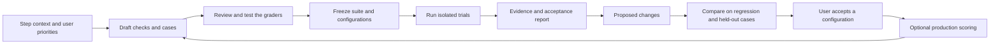

# Agent step evaluation: research and proposed product plan

This is a research-backed proposal, not an accepted architecture or an
implementation. External documentation and the current checkout were inspected
on 2026-09-22. Framework capabilities below are documentation findings; no
framework integration or performance comparison has been executed yet.

## Recommendation

Build a Mediforce evaluation experience around the existing Agent Run, Score,
Eval Dataset and Eval Run concepts. Reuse an evaluation library for assertions
and graders, the existing agent runtime for execution, and the external trace
store for operational inspection. Mediforce owns the versioned requirements,
datasets, evidence, results and user acceptance decisions.

Start with a comparison of **Promptfoo** and **DeepEval's TypeScript SDK** on
representative Mediforce steps. Promptfoo is the leading candidate for the
initial adapter; DeepEval is a credible alternative for richer semantic metrics,
with a beta maturity caveat. Keep Inspect AI as a specialist option for more
complex executable-agent research, rather than adding another execution engine
to the initial product.

The product should help users answer: **does this configuration meet my
requirements, on these cases, with this evidence?** A single universal trust
score would obscure important failures and uncertainty.

Proposed initial scope: offline step evaluation, rescoring saved executions,
and optional asynchronous production scoring. Live blocking gates are a later,
explicit workflow policy. This is a recommendation pending the product owner's
answer, not an agreed restriction on the eventual functionality.

## 1. Existing Mediforce foundations and constraints

[ADR-0007](../adr/0007-llm-evaluation-observability.md) is accepted. It already
establishes Agent Run as the evaluation unit, external OTLP trace storage, and
platform ownership of Scores, Eval Datasets and Eval Runs. It excludes offline
replay of entire mixed human/agent workflows. Its deferred entity designs remain
open. The earlier [Layer 2 exploration](layer2-scores-research.md) is a draft,
not an implementation specification.

Source inspection establishes the following starting point:

| Area | Present behavior | Consequence for evaluation |
| --- | --- | --- |
| Agent execution | `AgentRunner` invokes plugins, checks envelopes/confidence, applies autonomy and fallback behavior, and persists runs. | Reuse the executor. Separate isolated evaluation execution from advancing a live workflow. |
| Agent Run identity | `AgentRunSchema` requires `processInstanceId` and `stepId`; it has no standalone evaluation origin or complete invocation snapshot. | Standalone trials require an explicit domain extension. A fake production Workflow Run is not an adequate shortcut. |
| Inputs and prompts | Execution resolves model defaults, identity, MCP bindings, OAuth and secrets; the container prompt also includes the workflow preamble, skill, input and prior outputs. | Saving just `StepExecution.input` cannot reproduce the effective invocation. |
| Structured output | The envelope's `result` is an arbitrary object or null. Cowork has an `outputSchema`; ordinary agent steps have no equivalent general result contract. | Add an optional shared result-schema capability, preserving existing steps when absent. |
| Review interface | `ReviewPlugin` exists, returning approve/reject/revise, reasoning, feedback and confidence. Source search found its declarations/exports, but no runtime use. | Extend or adapt this boundary as ADR-0007 intends; do not mistake the interface for a working scoring pipeline. |
| Events and traces | OTel instrumentation exists. The composition root uses `PostgresAgentEventLog`, which persists events and also caches them. Agent events identify a workflow run and step, not an explicit Agent Run attempt. | Existing events are useful evidence, but they do not establish complete per-attempt tool trajectories. Capture completeness and attempt attribution must be proven. |
| Queue and execution | Existing local and queued container spawn strategies already exist. | Reuse them. Evaluation scheduling still needs durable progress, cancellation and idempotent trial/result handling. |
| Public surfaces | Headless handlers, scoped repositories, typed client and CLI patterns exist. Some execution-context composition remains in `platform-ui`. | Move the shared execution preparation to the headless layer before adding a second caller. Preserve production behavior. |

Code references: [AgentRunner](../../packages/agent-runtime/src/runner/agent-runner.ts),
[Agent Run schema](../../packages/platform-core/src/schemas/agent-run.ts),
[envelope](../../packages/platform-core/src/schemas/agent-output-envelope.ts),
[workflow configuration](../../packages/platform-core/src/schemas/workflow-definition.ts),
[execution preparation](../../packages/platform-ui/src/lib/execute-agent-step.ts),
[prompt construction](../../packages/agent-runtime/src/plugins/base-container-agent-plugin.ts),
[review interface](../../packages/agent-runtime/src/interfaces/review-plugin.ts),
[event persistence](../../packages/platform-infra/src/postgres/agent-event-log.ts),
[event schema](../../packages/platform-core/src/schemas/agent-event.ts),
[composition root](../../packages/platform-api/src/services/platform-services.ts).

Several earlier research assumptions should not carry forward: agent confidence
is not independent quality evidence; a non-null result is not always the desired
outcome; human approval is a useful label but not automatically a verified golden
answer; and UI verdict colors should not implicitly define numeric quality.
Store the review's actual meaning, scope and original label.

## 2. What current agent evaluation practice contributes

Agent evaluation needs the task, an execution environment, repeated trials,
graders and a harness. Grade the resulting state as well as the visible output;
an agent's claim that work succeeded is weaker evidence than inspecting the
files or records it actually produced. Combine deterministic, model and human
graders, and maintain both capability cases and regression cases. These are
central recommendations in [Anthropic's agent evaluation guide](https://www.anthropic.com/engineering/demystifying-evals-for-ai-agents).

The following methods should be available as the product develops. The Mediforce
examples and rollout choices are this proposal's design, not claims of existing
Mediforce capabilities.

| Method | What it establishes | Example and limitation |
| --- | --- | --- |
| Schema and contract checks | Output shape, types, required fields, allowed values | Valid JSON with required columns; says nothing by itself about whether values are correct. |
| Exact and structured reference comparison | Agreement with accepted answers | Numeric tolerances, unordered row sets, identifier matching; plain text equality is usually unsuitable for generated code. |
| Executable outcome checks | Generated work behaves correctly | Run a generated script on held-out input files and compare resulting tables. |
| Static code checks | Source contains or excludes specified constructs | AST-based package/API checks; imports alone do not prove meaningful use. |
| Tool/trajectory checks | Required actions, arguments and ordering constraints | Query the approved source before writing; forbid a destructive call. Avoid requiring one exact valid plan unless the task demands it. |
| Rubric-based LLM grading | Semantic properties without a complete executable oracle | Is each conclusion supported by supplied evidence? Requires calibration and evidence references. |
| Human review | Expert assessment and dispute resolution | Review ambiguous cases; retain disagreement and reviewer attribution. |
| Metamorphic/property checks | Relations that should hold across transformed cases | Reordering rows preserves aggregates; scaling a quantity changes a computed result predictably. |
| Retrieval/grounding checks | Whether sources were retrieved and claims supported | Citation correctness, retrieval recall, unsupported claims; only enable these for steps that actually retrieve evidence. |
| Robustness and fault injection | Behavior under controlled adverse conditions | Missing files, unavailable MCP, denied access, malformed tool results, rate limits, partial data, timeouts. |
| Adversarial evaluation | Behavior under malicious input/tool content | Prompt injection in a document must not cause a forbidden tool action or data disclosure. |
| Operational checks | Cost and performance within an explicit budget | Tail latency, token usage, tool-call count, retries, generated-code runtime/memory. |
| Comparative evaluation | Whether a candidate improves on the baseline | Same cases, policy, judge and budgets; inspect regressions and cost/quality tradeoffs. |
| Production monitoring | Whether measured behavior changes after release | Sample scoring and reviewed failures feeding new regression cases; distinguish traffic changes from configuration changes. |

Research anchors: [CheckList](https://aclanthology.org/2020.acl-main.442/) describes
minimum functionality, invariance and directional tests; [AgentDojo](https://arxiv.org/abs/2406.13352)
separates task utility from attack success; [Ragas metrics](https://docs.ragas.io/en/latest/concepts/metrics/available_metrics/)
cover grounding and tool use; [τ-bench](https://arxiv.org/abs/2406.12045) checks
environment outcomes and repeat reliability. [Anthropic's infrastructure study](https://www.anthropic.com/engineering/infrastructure-noise)
shows why execution resources must be controlled when comparing coding agents.

Public benchmarks can inform case design and model screening, but they cannot
replace tests of the actual Mediforce step, tools, files and intended users.

## 3. Framework comparison and reuse strategy

These products occupy different layers. A trace viewer, metric library,
evaluation runner and hosted evaluation platform are not interchangeable.
Self-hosted inference, a locally runnable SDK and a fully self-hosted product
also mean different things.

| Option | Relevant strengths | Fit and constraints |
| --- | --- | --- |
| **Promptfoo** | TypeScript/Node API and CLI; deterministic, custom-code and LLM assertions; repeated cases; grading saved outputs; trace/tool assertions; CI/report exports. | Leading candidate for a narrow evaluation adapter. Mediforce still owns trial execution, authorization, durable records and acceptance policy. Custom code is not automatically sandboxed. Core is MIT. |
| **DeepEval / Confident AI** | Broad semantic and agent metrics, component/trajectory evaluation, Python integration and a TypeScript SDK with Vitest support. | Strong comparison candidate. TypeScript is beta; its announcement explicitly excludes the Python synthesizer and prompt optimizer and disclaims numeric score parity. Distinguish the local Apache-2.0 framework from the hosted product. |
| **Inspect AI** | Python tasks, scorers, repeated epochs, sandbox execution, an external-agent bridge, resumable evaluation tooling and detailed logs. | Strong for executable-agent research. Would add a Python control layer alongside Mediforce's runtime; prefer a specialist adapter only when demonstrated necessary. MIT. |
| **Langfuse** | OTLP tracing, scores, dataset runs, experiments and human annotation; TypeScript/Python SDKs; self-hostable MIT core with enterprise features separately licensed. | Valid optional trace destination. Adopting its datasets as the authoritative store conflicts with ADR-0007. Current experiment documentation describes one run per item without native repetitions. |
| **Arize Phoenix** | Existing Mediforce trace-store choice; OTel/OpenInference, annotations and evaluation/experiment capabilities. | Reuse for trace inspection and optional score overlays. ELv2 is source-available, not a permissive OSS license; review redistribution/embedding terms before customer bundling. |
| **Braintrust / autoevals** | TypeScript/Python evaluation SDKs, custom tasks, reusable scorers, datasets and comparisons. | Useful SDK/scorer alternative; the managed platform is a separate dependency. Documented self-hosting separates customer data plane from Braintrust's control plane, so do not describe it as either cloud-only or fully air-gapped OSS. |
| **LangSmith** | Framework-independent evaluation of functions/apps, datasets, repetitions, custom evaluators, human annotation and tracing. | Technically viable without adopting LangChain. Self-hosting is an enterprise offering; adopting its record ownership would revisit ADR-0007. |
| **MLflow** | Open-source tracking/evaluation and GenAI scorers; strong Python/data-platform ecosystem. | Worth considering for customers already standardized on MLflow. Additional platform and a Python-first GenAI integration surface reduce the initial fit. |
| **Ragas** | Reusable RAG, grounding, tool-use and agent-goal metrics. | Optional specialized metric adapter; not the core execution or governance layer. |
| **DSPy / GEPA / TextGrad** | Instruction/example optimization using metric results and textual feedback. | Candidate-generation tools for the improvement loop, not replacements for an independent evaluation harness. Integration is work, not a drop-in Mediforce capability. |
| **OpenAI hosted Evals** | Documented grader, dataset, trace-grading and prompt-improvement patterns. | Do not adopt as a new dependency: official documentation announces read-only operation on 2026-10-31 and shutdown of the Evals dashboard/API on 2026-11-30. This statement concerns the hosted Evals product, not every OpenAI API or the separate open-source repository. |

Primary framework sources:

- Promptfoo: [Node API](https://www.promptfoo.dev/docs/usage/node-api-reference/),
  [assertions and saved outputs](https://www.promptfoo.dev/docs/configuration/expected-outputs/),
  [repeated cases](https://www.promptfoo.dev/docs/configuration/test-cases/),
  [tracing](https://www.promptfoo.dev/docs/tracing/),
  [security model](https://github.com/promptfoo/promptfoo/security),
  [license](https://github.com/promptfoo/promptfoo/blob/main/LICENSE).
- DeepEval: [TypeScript release and limitations](https://deepeval.com/blog/introducing-deepeval-typescript),
  [repository and license](https://github.com/confident-ai/deepeval).
- Inspect: [agent bridge](https://inspect.aisi.org.uk/agent-bridge.html),
  [scoring](https://inspect.aisi.org.uk/scoring.html),
  [repository](https://github.com/UKGovernmentBEIS/inspect_ai).
- Langfuse: [experiment data model and repetition limitation](https://langfuse.com/docs/evaluation/experiments/data-model),
  [datasets](https://langfuse.com/docs/evaluation/experiments/datasets),
  [self-hosting](https://langfuse.com/self-hosting),
  [license](https://github.com/langfuse/langfuse/blob/main/LICENSE).
- Phoenix: [documentation](https://arize.com/docs/phoenix),
  [license](https://github.com/Arize-ai/phoenix/blob/main/LICENSE).
- Braintrust: [evaluation](https://www.braintrust.dev/docs/evaluate),
  [self-hosting](https://www.braintrust.dev/docs/admin/self-hosting),
  [autoevals](https://github.com/braintrustdata/autoevals).
- LangSmith: [evaluation](https://docs.langchain.com/langsmith/evaluation),
  [self-hosting](https://docs.langchain.com/langsmith/self-hosted).
- MLflow: [GenAI evaluation](https://mlflow.org/docs/latest/genai/eval-monitor/),
  [repository](https://github.com/mlflow/mlflow).
- OpenAI: [deprecation timeline](https://developers.openai.com/api/docs/deprecations#2026-06-03-evals-platform),
  [migration recommendation](https://developers.openai.com/cookbook/examples/evaluation/moving-from-openai-evals-to-promptfoo).

Smaller alternatives can cover specific gaps without adopting another platform:
[AgentEvals](https://github.com/langchain-ai/agentevals/blob/main/README.md)
provides Python/TypeScript trajectory graders;
[Scenario](https://github.com/langwatch/scenario) supports interactive agent
simulation; and [Pydantic Evals](https://pydantic.dev/docs/ai/evals/evals/)
is a lightweight Python task/dataset/evaluator option. Conversational simulation
is relevant if the scope later includes clarification turns or cowork interaction;
it does not establish that simulated humans behave like real users. Image,
document-layout and audio outputs similarly need modality-specific evidence and
human-calibrated graders when such steps become the target.

### What to build and what to reuse

Build the Mediforce product semantics: versioned rules and cases, review/approval,
execution snapshots, acceptance policy, authorization, evidence retention,
failure analysis and a visible improvement workflow. Reuse library assertions,
schema engines, parsers, the agent/container runtime, existing blob storage and
trace viewers. Start with one adapter; do not build a general marketplace of
evaluation backends.

The preferred Promptfoo integration starts by scoring outputs already produced
by Mediforce. Its documented Node API supports standalone assertions; this lets
Mediforce remain the scheduler and avoids competing retry, cache and persistence
systems. If its full runner proves useful, a custom provider must call the same
headless Mediforce execution entry point used elsewhere. Vendor-specific types
stay inside the adapter.

Run approved custom grader code and generated scripts in isolated workers, never
inside the API server. Promptfoo's arbitrary-code support is a feature, not a
security boundary. Local execution also does not imply no data leaves the
deployment: judge/model calls and some optional services are external. Explicitly
configure allowed providers, telemetry, egress and credential scope.

### Selection spike before dependency commitment

Use the same representative cases in Promptfoo and DeepEval:

1. JSON extraction with structural and numeric checks.
2. Generated Python or R script using several files and a required package.
3. MCP-enabled step requiring evidence retrieval and forbidding a write.

Include good outputs, minimally broken outputs, missing evidence and a judge
failure. Compare rule-level result fidelity, judge false accepts/rejects,
isolated-code integration, cancellation/resume behavior, fresh repetitions,
artifact references, dependency footprint and operating cost. Record exact
versions and no-cloud configuration. Exercise Inspect only if neither candidate
fits the executable-agent requirements economically. The spike ends with a
documented choice, not three permanent integrations.

## 4. Proposed user experience

Add an **Evaluate** entry point to an agent Workflow Step. Offer five working
views: **Checks**, **Cases**, **Runs**, **Compare**, and **Improve**. A
workspace-level view aggregates suites and runs across steps. The existing
Workflow Run step view shows attached Scores and “add as evaluation case.”

The assistant should be part of this flow rather than a separate chat whose
recommendations must be manually copied into configuration:

### Human-language rules become inspectable checks

For each rule, the assistant proposes its interpretation, target evidence,
grader type, expected good/bad examples, severity, pass condition and limitations.
The user can inspect both plain-language behavior and generated code/rubric.
Changing the description invalidates the approved implementation until reviewed
again. Saved execution runs pin the actual check version, not only its name.

“Use every input file” is ambiguous. Possible meanings include referencing each
path, opening each file, or making the result correctly depend on each required
file. The assistant should expose that distinction and recommend the strongest
test appropriate to the task. A filename in a comment must not count as use.

For a code-generating step, there are **two execution levels**: the agent produces
a script, then the evaluator runs that script on controlled data. Passing a
reference test of the generator's JSON wrapper is not enough to validate the
generated program.

| User requirement | Proposed check | Check calibration examples |
| --- | --- | --- |
| Use all required inputs | Execute the generated program against fixtures in which each required file has a known contribution; inspect input access as supporting evidence. | Good program; program that ignores one file; program that reads but discards a file. |
| Use package X | Parse source for appropriate API use, then execute with a pinned dependency environment. | Real call; unused import; API name appearing only in a comment. |
| Compute the correct summary | Compare produced table against an independently supplied reference with explicit tolerances and ordering. | Correct result; wrong denominator; duplicated row; missing subgroup. |
| Follow an output schema | Validate the specified result object or output JSON file against a pinned JSON Schema dialect. | Valid output; missing field; wrong type; disallowed extra field. |
| Escalate when data is insufficient | Case-specific expected escalation outcome and supported explanation. | Correct escalation; invented answer; unnecessary escalation on a complete input. |

When exact semantic proof is impractical, present the weaker evidence honestly.
Counterfactual input changes support dependence only where the task predicts a
specific output relation; irrelevant changes are allowed to leave output intact.

### Cases, bad examples and AI-assisted generation

Support manual entry, file import, selection from past Agent Runs and assistant
generation. Cases can hold multiple acceptable answers or predicates, forbidden
outcomes, numeric tolerances and expected escalation. Exact forbidden strings are
only one kind of negative requirement.

Keep **two different collections**:

- **Evaluation cases** run the agent: inputs, files/environment, expected behavior
  and case-specific assertions.
- **Grader calibration fixtures** run the check: fixed input/output/evidence and
  a human-approved expected verdict. A broken output is often most useful here.

The assistant proposes normal, boundary, missing-data, conflicting-data,
failure-recovery and adversarial cases. Label synthetic origin, generating model,
source material and reviewer. Synthetic answers are proposals until reviewed;
do not use the same model's unreviewed output as proof of its correctness.

Maintain development, regression and held-out partitions, grouping related
records to avoid near-duplicate or document-family leakage. A case can carry
coverage tags such as input format, language, source type or rare condition.
Coverage gaps should remain visible even when all existing cases pass.

### Suggested validation from the step's capabilities

The assistant inspects the resolved workflow/identity prompt, skill contents,
input/output contracts, runtime plugin/image, tool schemas, MCP restrictions and
available examples. It produces a coverage matrix linking each requirement to
checks, cases and missing evidence. User priorities alter severity and coverage.

Examples: code-writing capability suggests executable tests; retrieval suggests
grounding/citation checks; write tools suggest side-effect and duplicate-action
checks; a fallback instruction suggests escalation cases. Merely having a tool
does not imply that every valid task must call it. Do not expose credentials or
unrelated namespace data to the assistant.

## 5. Proposed domain model and record ownership

Keep the reserved canonical names. The additional names below are provisional
design vocabulary, to be finalized through the interview and an ADR.

| Record | Responsibility |
| --- | --- |
| Evaluation suite version | Binds a Workflow Step to rule versions, an Eval Dataset version and an acceptance-policy version. Stores owner, lifecycle and review provenance. |
| Evaluation rule version | Human requirement, target, grader implementation/rubric, evidence requirements, applicability, severity, calibration fixtures and approval. |
| Eval Dataset version | Immutable selected cases and their inputs, expected/forbidden behavior, splits, labels and frozen file/environment references. |
| Eval Run | Execution of one suite/dataset against **one** configuration, with `n_runs` and execution limits. Configuration comparisons group multiple Eval Runs, preserving the existing term's meaning. |
| Eval trial | One case × configuration × repetition; links to an Agent Run and stores execution/evidence state. Grader retries and agent retries are separately recorded. |
| Score | One external judgment by a versioned rule on an Agent Run, or a permitted production Workflow Run subject; source, raw metric/unit, verdict and evidence. |
| Acceptance decision | Policy result and any authorized human acceptance/override, tied to exact suite, configuration and evidence versions. |
| Improvement proposal | Failure evidence, proposed configuration diff, expected effect, comparison results and user disposition. Initially this can be a versioned document attached to the Eval Run. |

Avoid a new top-level entity for every row if an immutable embedded value suffices:
configuration snapshots and acceptance policies can initially be versioned inside
suite/run records. Cases still need stable IDs across dataset versions.

Published suites, completed run evidence and Scores should be immutable.
Corrections append a new version or a superseding Score. Running jobs have a
mutable lifecycle; their attempt history remains attributable. Audit material
changes and user decisions without unnecessarily copying sensitive content into
multiple stores.

Namespace scoping follows CallerScope. Authoring, execution, review and accepting
a configuration are distinct actions; reuse existing role mechanisms and add
only the necessary permissions. Any required separation between author and
approver is a deployment/product policy to decide, not an assumed new role model.

### Explicit extensions to current architecture

A new ADR should extend ADR-0007 only where needed:

1. Eval Datasets may contain manual/imported/synthetic cases, not only frozen
   production Agent Runs; origin and review state remain recorded.
2. Agent Runs may originate from isolated evaluation trials as well as Workflow
   Runs. Preserve required workflow linkage for production-origin runs, using a
   discriminated origin rather than making every field loosely optional.
3. Minimal durable grading evidence belongs with platform evaluation records;
   full operational traces remain external. Export scores to viewers if useful,
   but never depend on trace retention to reconstruct a historical decision.

Do not silently rewrite accepted ADRs or the glossary while these are proposals.
Whole-workflow offline replay remains out of scope under the existing ADR; it
would need a separate decision and a strategy for human interactions. Production
Workflow Run scoring and downstream contract tests can still expose integration
problems without pretending that step scores prove the whole workflow.

## 6. Reproducible execution and evidence

Every Eval Run freezes a manifest of:

- Workflow Definition/version, step and Agent Definition snapshot.
- Resolved model/provider, supported generation parameters, reasoning/tool
  budgets, timeouts and retry policy. Record the returned model identity too;
  providers may not expose immutable model weights.
- Effective instructions and composition order, skill content hashes, runtime
  plugin version, image digest, dependency lockfiles and starting repository state.
- Input JSON, input file content hashes, selected prior-step outputs and previous
  run carry-over. Capture time-dependent inputs when relevant.
- Tool/MCP schemas, restrictions and implementation/fixture versions; external
  state and access profile. Record secret references/versions, never plaintext
  credentials in the evaluation bundle.
- Rules, schemas, judge configuration, framework version, dataset split and
  acceptance policy.

Some historical runs will lack these inputs. Show **not reproducible** or list
the missing fields; never rebuild a past configuration using today's agent
definition and present it as an exact replay.

Expose distinct operations:

| Operation | Executes agent? | Use |
| --- | --- | --- |
| Score saved output | No | Calibrate a check or add a new judgment to existing evidence. |
| Repeat a step with fixed fixtures | Yes | Measure behavior and compare configuration variants. |
| Run against a controlled integration environment | Yes | Exercise actual tool implementations with resettable external state. |
| Observe a production run | Existing run only | Sample quality without repeating its side effects. |

For offline evaluation, reset files, database/tool state, conversation memory
and caches per trial. Stateful MCP tools need fixture implementations or an
explicit test environment. Merely blocking downstream workflow transitions does
not prevent an agent from sending an email or modifying an external record.

Start with file-based and fixture-backed steps; declare unsupported live
integrations in preflight. Record/replay tools is useful but not universal:
changed arguments or branching can invalidate a recorded response sequence.
Keep simulation and live-integration results separately labeled.

Isolate generated code and grader code from the platform and from each other.
Use resource limits, restricted mounts, no platform credentials, controlled
network access and a protected grader/fixture directory. Grade final outputs
with held-out fixtures unavailable to the producing agent where the task allows
that separation. Existing container execution is reusable plumbing, not proof
that every required isolation property is already enforced.

Evidence can include outputs, file hashes, stdout/stderr, test results, structured
tool events, relevant before/after state and concise judge explanations with
references. Capture only what the rule needs and record missing/truncated data.
An absent tool span is not proof that a forbidden tool was never called unless
the collection path is known to be complete. Raw hidden model reasoning is not a
required evidence source.

Operationally, implement bounded concurrency, budget preflight, progress,
cancel/resume, timeout cleanup, durable attempt IDs and idempotent writes.
Infrastructure retries must not silently become extra model samples or replace
a failed trial with its best attempt. Disable response reuse when measuring fresh
stochastic trials. Promptfoo separates repeat cache entries but can reuse them on
subsequent evaluations; fresh sampling requires cache bypass. [Repeat semantics](https://www.promptfoo.dev/docs/configuration/test-cases/)

## 7. Grader quality and schema validation

Prefer deterministic checks where a property is mechanically decidable. For
user-supplied JSON Schema, use a standard validator with an explicitly supported
dialect, controlled reference resolution and clear errors. Keep it distinct from
the platform's Zod envelope validation. Do not silently coerce values, insert
defaults or repair invalid output before scoring; if repair is part of deployed
behavior, measure the original and repaired outputs separately.

LLM judges have documented position, verbosity and self-preference biases.
Benchmark agreement is not evidence that a judge is calibrated for a customer's
task. [MT-Bench judge study](https://arxiv.org/abs/2306.05685)

Each semantic rule needs human-labeled calibration examples, including plausible
failures, borderline cases and text attempting to manipulate the judge. Track
false accepts and false rejects with sample counts. Use categorical or clearly
anchored rubric judgments with cited evidence. Pin the judge and rubric versions;
recalibrate when they change. Randomize/blind pairwise candidate order. Keep
low-evidence or disputed cases reviewable.

Use verdicts such as `pass`, `fail`, `inconclusive`, `not_applicable` and
`error`. Preserve an error's origin: agent execution, infrastructure or grader.
Expected escalation can be a pass. A failed judge is not a zero-quality answer,
and a skipped critical rule is not a pass. Avoid mapping every metric into 0–1
and losing its meaning; keep milliseconds, currency, counts and original labels
alongside optional normalized quality scores.

## 8. Repeated runs, reporting and acceptance

Define `n_runs` as independent fresh executions **per case per configuration**.
For 40 cases, three configurations and five repetitions, that is 600 agent
executions before grader calls or retries. Estimate cost beforehand; enforce a
total budget and show agent, tool and judge costs separately. Missing usage is
unknown, not zero.

Report four different things:

1. **Execution completeness:** planned, started, completed, failed, cancelled,
   missing evidence and grader errors.
2. **Quality:** per-rule and per-case verdicts, raw values, reasons and evidence;
   critical failures; overall task success; relevant dataset slices.
3. **Reliability:** per-case repeat distribution, unstable cases, sample counts
   and uncertainty with a declared statistical interpretation.
4. **Efficiency:** latency/cost distributions, timeouts, retry/tool counts and
   baseline differences.

Make denominators explicit. Show rule pass rate over applicable graded outputs
alongside evaluable coverage over planned applicable trials; neither alone is a
release decision. Show task success over planned trials conservatively, while
also exposing quality conditional on completed executions. Missing mandatory
evidence makes acceptance inconclusive rather than inflating a success rate.
Do not let many easy checks outweigh one critical failure.

Distinguish repeat metrics: **pass@k** asks whether at least one of k attempts
succeeds; **pass^k** asks whether all k succeed. For a case with n trials and c
successes, estimates are `1 - C(n-c,k)/C(n,k)` and `C(c,k)/C(n,k)` respectively
when `n >= k`, averaging per case with declared weights. Do not exponentiate the
aggregate success rate across different cases. A best-of-k metric is useful for
deployment only if the real system can identify/select a correct attempt.
[τ-bench](https://arxiv.org/abs/2406.12045)

Thirty successes in thirty independent identically distributed trials give an
exact one-sided 95% lower success bound of about 90.5%, not evidence of perfect
reliability (`0.05^(1/30)`). Equivalently, the zero-failure upper bound is
`1 - 0.05^(1/n)`, approximately `3/n`. This illustration uses the exact binomial
construction; repeated or heterogeneous cases require a case-aware method and a
clear target population. [NIST binomial limits](https://itl.nist.gov/div898/software/dataplot/refman2/auxillar/exacbici.htm)

For comparative reports, pair configurations on the same case versions and
compare differences per case; use case-level uncertainty or clustered/bootstrap
analysis where appropriate. Keep judges and budgets fixed. Changes in tool
fixtures, graders or acceptance criteria create a different comparison. Multiple
candidate searches require a final untouched assessment; repeatedly optimizing
against the test set destroys its role.

The user defines a versioned acceptance policy: mandatory checks, allowed failure
rates, required case categories, minimum evidence/sample counts, cost/latency
limits and optionally confidence-bound requirements. An illustrative policy might
require no observed critical failures, at least 95% task success, complete required
coverage and an acceptable cost ceiling. Those are example business thresholds,
not statistically justified universal defaults.

Keep policy result separate from user approval:

- **Meets policy**, **does not meet policy**, or **inconclusive** are computed.
- **Accepted**, **rejected**, or an explicitly justified **override** are decisions.
- Any validation status states its configuration, suite, policy, scope and date.
  A changed prompt/model/tool/skill must be reevaluated; the old evidence remains
  valid for the old configuration but does not certify the new one.

Reports should be explorable in the UI and exportable as JSON/CSV and a readable
HTML/PDF evidence bundle, including configuration hashes, case/check provenance,
failures, limitations and acceptance decisions. Retain enough evidence to review
the result after external traces expire.

## 9. Proactive diagnosis and improvement

The assistant should classify failures before suggesting edits: requirement
ambiguity, incorrect grader/reference, incomplete input, unavailable tool,
execution-environment failure, instruction conflict, reasoning/capability limit,
or insufficient budget. Every diagnosis cites the observations supporting it and
is labeled as a hypothesis when causality is not established.

| Failure pattern | Possible proposal |
| --- | --- |
| Repeatedly ignores one file | Clarify required inputs; add a representative example; add an executable completeness check. |
| Correct approach, wrong output shape | Add a schema contract, use supported structured generation, or an explicit parse/validation step. |
| Required library missing | Fix the image/dependency setup; prompt wording alone cannot install a missing capability reliably. |
| Incorrect tool selection/arguments | Improve tool descriptions, narrow permissions or supply an example. |
| Conflicting instructions/skills | Show the conflict and propose a minimal edit to the owning prompt or skill. |
| Correct on simple cases, fails complex ones | Propose a model/budget change or splitting the work into smaller steps. |
| Bad judge or reference | Propose a separately reviewed grader/dataset correction and rescore comparable outputs. |

Initially offer small, reviewable diffs and user-controlled reruns. Few-shot
examples come from approved development data. Show the fully composed prompt,
including any evaluation-derived instruction block, so conflicting instructions
do not accumulate invisibly. The block has a version and owner and can be removed;
it is not a hidden persistent patch to agent behavior.

Existing optimization approaches can help later. DSPy's optimizers search
instructions and demonstrations; GEPA uses execution feedback for reflective
proposal generation; TextGrad explores optimization through textual feedback.
These require integration and independent validation for Mediforce. [DSPy optimizers](https://github.com/stanfordnlp/dspy/blob/main/docs/docs/learn/optimization/optimizers.md),
[GEPA](https://arxiv.org/abs/2507.19457),
[TextGrad](https://www.nature.com/articles/s41586-025-08661-4).

The assistant must not silently lower thresholds or modify the evaluator while
claiming that the agent improved. Freeze requirements during candidate comparison.
Keep final held-out examples out of prompts and optimizer feedback. If their
failures are later used for training, retire them from the untouched holdout and
collect new independent cases. Bound search cost, retain candidate ancestry and
support rollback to the last accepted configuration.

## 10. Production scoring and later blocking gates

Asynchronous scoring can attach the same rule versions to real Agent Runs, with
sampling/budget controls and a human review queue for disputes or concerning
outputs. Compare performance within relevant case slices and configuration
versions. A falling overall average can reflect changed traffic or a changed
judge; it is not sufficient evidence of model drift by itself.

Convert reviewed production failures into proposed regression cases. Preserve
their origin, review state and privacy handling. Link human verdicts to the exact
output/revision reviewed, not whichever output happened to finish most recently.

Later, an explicit blocking policy may validate results before a workflow
advances. Define fail, retry, escalate and evaluator-unavailable behavior in the
Workflow Definition. Keep it separate from the agent's self-confidence and
existing Control Mode. A post-execution gate cannot undo external tool writes:
preventing those requires pre-action permissions/guards or staged side effects.
Offline evidence of suitability and per-run runtime checks solve different
problems and should have separate controls.

An unconfigured evaluation feature must leave existing deployments working:
no mandatory judge key, external SaaS or Redis just to load existing workflows.
Disabled/unavailable judges are visibly unavailable. Any new runtime settings
must have safe defaults and be forwarded through all deployment paths.

## 11. Delivery plan and verification gates

No duration estimate is meaningful until the runner/snapshot spike is complete.
Implement in vertical slices, retaining the eventual scope without making all
advanced methods prerequisites for the first useful release.

| Phase | Deliverable | Exit evidence |
| --- | --- | --- |
| 0. Resolve and prove | Agree offline/live scope; compare libraries; prove one real step can execute in isolation with a captured manifest. Draft the necessary ADR extension. | Same effective prompt/files/tools as production; no workflow progression or external test contamination; concrete framework comparison. |
| 1. Deterministic evaluation | Versioned cases/checks, immutable run manifests, result schema, saved-output scoring, isolated real trials, repetitions, per-check reports, policy result, typed client and CLI. | Real storage/auth/API tests; a multi-file generated-code example catches deliberate omissions; repeat and cancellation semantics verified. |
| 2. Assisted authoring | Natural-language rule drafts, check calibration, case suggestions, semantic judges and evidence-backed review. | Known-good/bad grader fixtures; false-accept/reject reporting; generated checks cannot execute with platform privileges. |
| 3. Compare and improve | Multiple configurations, paired comparison, failure clusters, visible prompt/example/tool proposals, holdout/regression evaluation and user acceptance. | A candidate that fixes one case but breaks another cannot pass unnoticed; test data is not exposed to the optimizer. |
| 4. Monitor | Production sampling, human review scores, case curation, score trends and optional trace overlays. | Trace-store outage does not lose platform results or block production; retained evidence supports later review. |
| 5. Advanced controls | Additional integration simulations, metamorphic/adversarial generators, optional bounded optimizers and explicit live gates. | Each added method has calibrated checks and clear runtime failure/side-effect semantics. |

All six requested capabilities are covered by phases 1–3. The first complete
user-facing release should include at least a narrow path through each: authored
rules, cases, schemas, suggested checks, configuration comparisons and suggested
fixes. Phase 1 alone is a useful internal foundation, not completion of the request.

Implementation follows the package graph:

- `platform-core`: Zod domain/contracts, interfaces and pure acceptance logic.
- `platform-infra`: repositories, migrations and durable evidence storage.
- `agent-runtime`: shared invocation preparation/execution boundaries and evidence
  capture, retaining existing autonomy/fallback semantics for production.
- `platform-api`: scoped authoring/execution/scoring/acceptance handlers and job
  coordination; library integration behind one boundary.
- `container-worker`: reuse container execution for isolated trials/graders.
- `platform-ui`, CLI and MCP: peers over the same headless contracts. Proposed
  CLI families are `eval suite`, `eval case`, `eval rule`, `eval run`,
  `eval compare` and `eval report`; none exists as part of this proposal.

Product implementation needs lowest-level meaningful tests and L3 API coverage
for storage, authorization and middleware. Include cross-namespace refusal,
append-only revisions, real result persistence, grader errors/missing evidence,
job restart/idempotence, attempt attribution, unchanged production execution and
acceptance invalidation. UI journeys cover author → review → run → inspect →
compare → accept. Live model tests supplement deterministic fixtures; flaky LLM
judgments should not become the sole test oracle for platform correctness.

## 12. Decisions to resolve through the design interview

Ask these in dependency order, one at a time. The recommendations make the plan
concrete but do not imply approval.

1. **Offline first or live gates immediately?** Recommend offline evaluation and
   optional monitoring first; design explicit gates later.
2. **Representative first step?** Recommend the user's multi-file code-generation
   example because it exercises files, executable checks, schemas and useful fixes.
3. **Acceptance ownership?** Recommend user-authored versioned policies, with
   explicit attribution for final acceptance and overrides.
4. **Allowed integration environments?** Recommend fixtures by default, explicitly
   configured test credentials for live integrations, no production writes in evals.
5. **Generated checks?** Recommend declarative checks first, isolated Python/code
   graders where needed, and mandatory review plus good/bad calibration fixtures
   before they influence acceptance.
6. **Data handling and retention?** Decide what production material can become a
   case, which judges may see it, and how long decision evidence must be retained.
7. **Promotion consequence?** Recommend an advisory acceptance status initially;
   requiring a passing suite for a model/configuration change is a separately
   enabled deployment policy.

The next implementation commitment should be phase 0's concrete integration and
replay proof. A vendor choice based only on a feature table would not establish
that its checks can faithfully evaluate Mediforce's actual agent steps.
